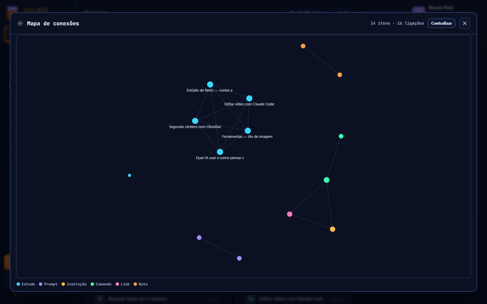

# MyLoot

**Seu inventário pessoal.** Um app que roda no seu próprio computador para guardar e achar rápido PDFs, prompts, comandos, links, notas, tarefas, clientes e o seu financeiro — com cara de joguinho: XP, níveis, missões, sons e confete.

Sem conta, sem nuvem, sem mensalidade. Seus dados ficam numa pasta sua. Funciona no **Windows, Mac e Linux**, e dá para usar **no celular** pela rede de casa.

▶️ **[Tutorial completo com som (3 min 28)](docs/video/myloot-tutorial.mp4)** · [apresentação rápida da versão anterior, quando se chamava Mochila (50 s)](docs/video/mochila.mp4)

⭐ Curtiu? Deixe uma estrela no repositório: ajuda outras pessoas a encontrarem o projeto.

## Novidades da versão 2.5

- 🎙️ **Crie falando**: aperte o microfone (ou a tecla `V`), fale, e o que você disse vira nota, tarefa ou conta. Também aceita áudio do WhatsApp. A transcrição roda no seu computador (Whisper no navegador); na primeira vez ele baixa o motor de voz, uns 80 MB.
- ✨ **A IA organiza a fala**: “ligar pro Rafael amanhã às 10, paguei 120 de internet e anotar a ideia do post” vira uma tarefa com data e hora, uma conta paga e uma nota. Usa o Claude Code, o Codex ou a chave da API que você já ligou.
- 🔄 **Celular e PC juntos**: com os dois abertos, o que muda em um aparece no outro sem apagar nada. Áudio gravado no celular é transcrito pelo PC.
- 🐞 **Reportar um problema**: no menu e nas Configurações. Abre um formulário já preenchido com o que você escreveu, a versão e os últimos erros.
- 🔌 **Conexões**: em Configurações, gere um código para outro programa do seu computador mandar itens para o MyLoot. Ele só acrescenta itens; não lê nem apaga o que você guardou.

## Novidades da versão 2.4

| No celular, por QR Code | Clientes |
|---|---|
|  |  |

| Financeiro | Kit do negócio |
|---|---|
|  |  |

## O que tem dentro

- **Mapa de conexões** na tela inicial, no estilo do Obsidian: cada item vira uma bolinha colorida pelo tipo e se liga sozinho a outros por etiquetas, categoria e menções (`[[Título]]`). Passe o mouse para ver as ligações, clique para abrir e amplie em tela cheia.
- **Biblioteca** com 6 tipos de item (Estudo/PDF, Prompt, Instrução, Comando, Link, Nota), categorias, etiquetas e favoritos.
- **4 jeitos de ver:** grade, lista, tabela e quadro estilo Trello (arrastando os cartões).
- **Busca em tudo** com `Ctrl+K` — títulos, textos, etiquetas e nome dos anexos.
- **Anexos:** arraste um arquivo para a janela e ele vira um item. Dá para pré-visualizar e abrir no programa do computador.
- **Clientes (mini CRM):** contato, WhatsApp, e-mail, Instagram, status do funil (prospect, ativo, pausado, encerrado), link do quadro do Trello e a pasta do cliente com um clique. As tarefas e os itens de cada cliente ficam juntos na ficha dele. Ótimo para social media e freelancer.
- **No celular:** ligue "Usar no celular" nas Configurações, aponte a câmera para o QR Code e pronto. Protegido por um código, só na sua rede. Dá para adicionar à tela inicial como um app.
- **Financeiro:** fluxo de caixa do mês com entradas e saídas, o que já foi pago/recebido e o que falta, contas que repetem todo mês, parcelas, pagamentos por cliente, gráfico dos últimos 6 meses, calculadora de valor da hora e planilha em CSV. O computador avisa das contas do dia.
- **Kit do negócio e Kit de lançamento:** 23 materiais prontos, cada um com texto editável e um PDF: briefings (social media, posts, identidade visual, site), contratos, proposta comercial, roteiro de call de vendas, mensagens de WhatsApp, onboarding, debriefing, relatório mensal, planejamento de conteúdo, avatar, objeções, oferta, cronograma e roteiro de lançamento. São **exemplos de referência** (os PDFs levam a identidade da Prestes Design): adapte para a sua marca, e cada material traz uma dica de como fazer isso com IA.
- **Tutorial guiado:** na primeira vez em cada tela, o MyLoot destaca os pontos principais passo a passo. Dá para pular e rever depois nas Configurações.
- **Modelos:** briefing de cliente, roteiro de Reels, checklist de post e reunião. Qualquer item pode virar modelo.
- **Instruções prontas:** prompts para o Claude Code ou o Codex organizarem seus arquivos (Downloads, fotos, repetidos, área de trabalho, pastas de clientes), sempre mostrando o plano antes e sem apagar nada.
- **Leitor em blocos:** arquivos `.md` e `.txt` abrem formatados em cartões fáceis de ler, com botão de copiar nos trechos de código.
- **Tarefas e calendário:** escreva "pagar conta amanhã" e a data entra sozinha. Tarefas podem **repetir** (todo dia, dias úteis, semana, mês) e ter **lembrete com horário**, que avisa no computador mesmo com o navegador fechado.
- **Modo foco:** timer que continua contando com o navegador fechado e avisa na área de trabalho.
- **Joguinho:** XP, níveis, meta do dia, missões, sequência de dias e conquistas. Tudo pode ser desligado.
- **IA (opcional): Claude ou Codex.** Peça para melhorar, corrigir ou resumir qualquer texto. O MyLoot acha sozinho o [Claude Code](https://claude.com/claude-code) e o [Codex](https://developers.openai.com/codex) instalados no seu PC e usa a sua própria assinatura, sem chave e sem custo extra. Na primeira vez, ele pergunta quais você quer usar. Sem nenhum dos dois, dá para colar uma chave da API do Claude.
- **Notion e Trello (opcional):** envie qualquer item para uma página do Notion ou para uma lista do Trello com um clique.
- **Google Drive (opcional):** copia tudo como arquivos `.md` para a sua pasta do Drive.
- **Exportar para o Obsidian:** baixa um ZIP com tudo em Markdown (itens, anexos, clientes e tarefas), pronto para abrir como cofre.
- **Backup com senha:** um arquivo `.myloot` criptografado (AES-256) para guardar onde quiser.
- **Central de ferramentas:** 42 links de IAs de imagem e vídeo e de programas de código aberto, com busca e botão para guardar na sua Biblioteca.
- **Já vem com 5 guias em PDF** sobre IA, edição de vídeo e organização.

| Biblioteca | Cartão do item |
|---|---|
|  |  |

| Quadro (arrastando os cartões) | Central de ferramentas |
|---|---|
|  |  |

| Leitor em blocos (.md e .txt) | Conquistas |
|---|---|
|  |  |

| Mapa de conexões | Calendário |
|---|---|
|  |  |

## Como instalar (Windows)

▶️ **[Veja o vídeo de instalação passo a passo (55 s)](docs/video/myloot-como-instalar.mp4)**

1. Instale o **Node.js** (versão LTS): https://nodejs.org — é só avançar até o fim.
2. Nesta página, clique no botão verde **Code → Download ZIP** e extraia a pasta onde quiser.
3. Dê dois cliques em **`Instalar.bat`**. Ele cria o atalho "MyLoot" na área de trabalho e abre o app.

Pronto. Nas próximas vezes, é só abrir pelo atalho.

## Como instalar (Mac)

1. Instale o **Node.js** (versão LTS): https://nodejs.org
2. Baixe o ZIP (botão verde **Code → Download ZIP**) e extraia.
3. Clique com o **botão direito** em **`Instalar.command`** → **Abrir** → **Abrir** de novo (o Mac pede essa confirmação na primeira vez porque o arquivo veio da internet).

Ele cria o app **MyLoot** na Mesa, com o ícone do baú, e já abre.

## Como instalar (Linux)

1. Instale o **Node.js** (versão LTS) pelo site ou pelo gerenciador de pacotes.
2. Baixe o ZIP e extraia.
3. No terminal, dentro da pasta: `sh instalar.sh`

Ele coloca o MyLoot no menu de aplicativos e na área de trabalho.

## Usar no celular

1. No computador: **Configurações → Usar no celular** → ligue a chave.
2. No celular (no mesmo Wi-Fi): aponte a câmera para o QR Code, ou digite o endereço que aparece e o código de 6 números.
3. Para virar app: no menu do navegador, **Adicionar à tela inicial**.

O computador precisa estar ligado com o MyLoot aberto. No Windows, se aparecer o aviso do firewall, permita em **redes privadas**. Para usar fora de casa, instale o [Tailscale](https://tailscale.com) (grátis) no PC e no celular. Algumas coisas ficam só no computador: desligar, atualizar, trocar chaves e abrir arquivos no PC.

> Antes se chamava **Mochila**. Se você já usava, é só copiar a versão nova por cima: seus dados continuam iguais.

> Não precisa de `npm install`: o app usa só o que já vem com o Node.

## Como usar

| Tecla | O que faz |
|---|---|
| `Ctrl+K` ou `/` | Buscar em tudo ou dar um comando |
| `N` | Novo item |
| `V` | Criar por voz |
| `H` `B` `T` `C` `L` `M` | Início, Biblioteca, Tarefas, Calendário, Clientes, Financeiro |
| `F` | Começar ou parar o foco |
| Clique direito no cartão (no celular: segurar o dedo) | Abrir, copiar, favoritar, enviar ao Notion/Trello, mover, duplicar, lixeira |

Para desligar: **Configurações → Desligar**.

## Onde ficam os meus dados?

Tudo fica na pasta `data/`, dentro da pasta do app:

- `data/db.json` — itens, tarefas e progresso
- `data/anexos/` — os arquivos que você anexou
- `data/backups/` — uma cópia automática por dia (guarda as 20 mais novas)

A chave da API do Claude e as do Notion e do Trello ficam em `data/segredos.json`, fora do backup e do GitHub.

Nada sai do seu computador, a não ser que você ligue o Drive, use o Claude ou envie um item para o Notion/Trello.

## Como atualizar

A partir da versão 2.2, **o próprio MyLoot avisa** quando sai versão nova: é só clicar em **Atualizar agora**. Ele baixa do GitHub, troca só os arquivos do app e reabre sozinho, sem mexer nos seus itens. Dá para procurar na hora em **Configurações → Versão**.

Se você tem uma versão mais antiga (ou ainda a Mochila), baixe o ZIP novo uma última vez e copie por cima, **menos a pasta `data/`**. Seus dados são migrados sozinhos ao abrir.

## Por dentro

- Servidor: Node.js puro (`server.js`, `integracoes.js`, `celular.js`, `exportar.js`), sem dependências. Só em `127.0.0.1:4321`, a não ser que você ligue "Usar no celular".
- Interface: HTML, CSS e JavaScript puros em `public/`.
- Conteúdo inicial: arquivos em `exemplos/` (cada `.json` é um pacote que entra uma vez só).

## Novidades

O repositório vai sendo atualizado: quando houver material novo (guias, links, melhorias), ele entra aqui e o app avisa você.

## Licença

[MIT](LICENSE) — use, mude e compartilhe à vontade.

Feito por [Prestes Design](https://prestesdesign.com.br) com ajuda do Claude.
