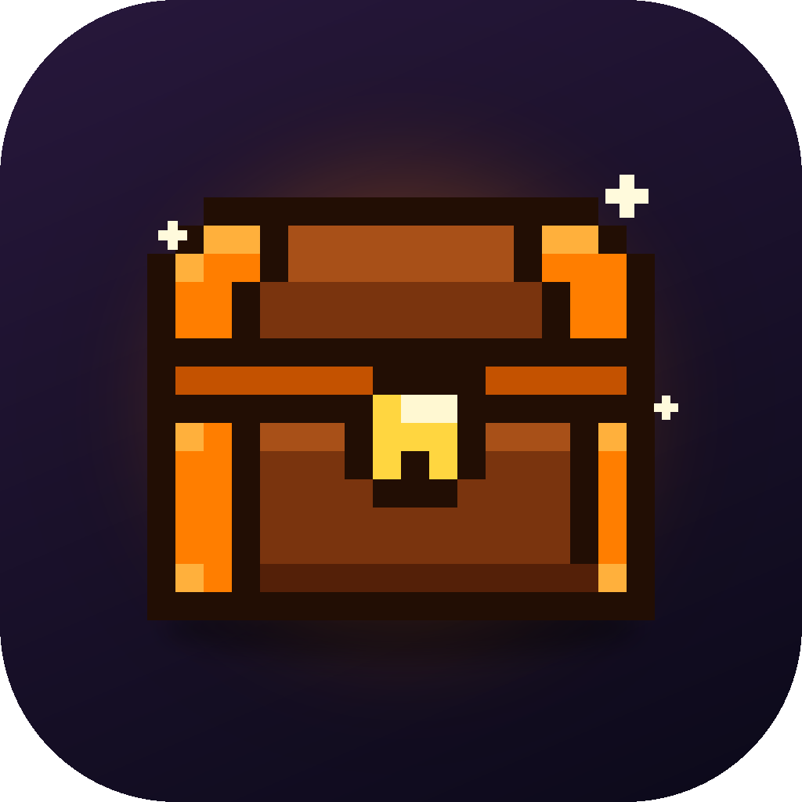
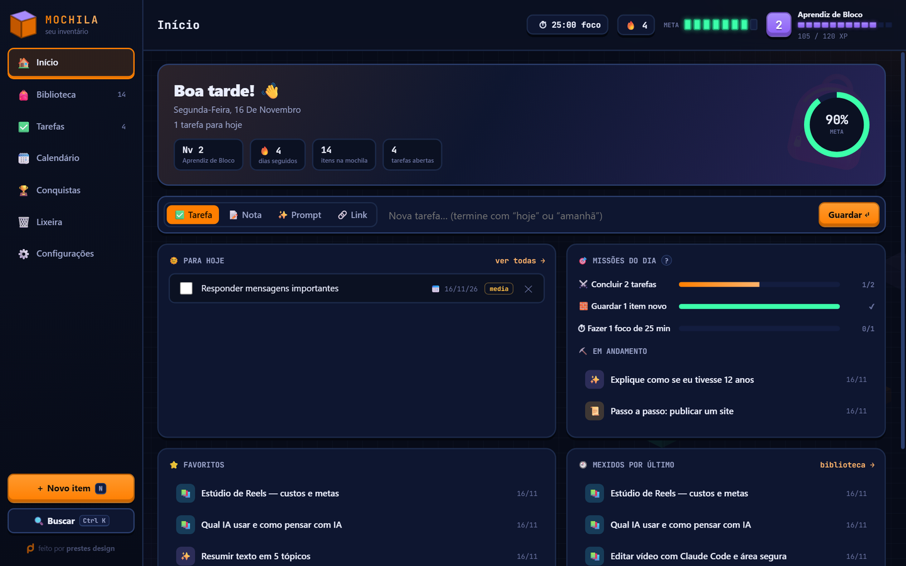
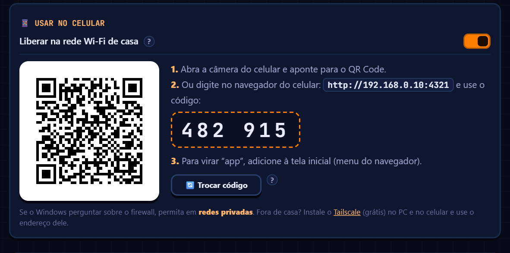
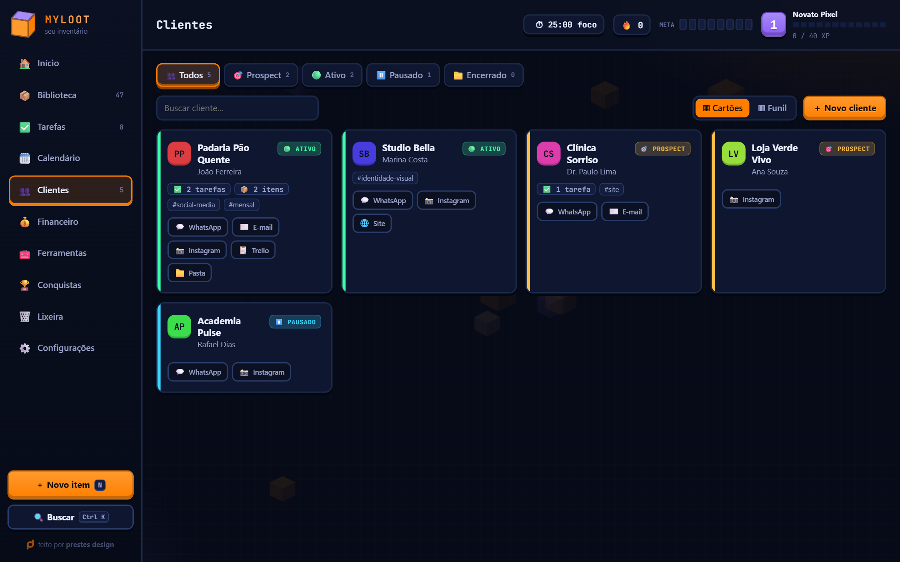
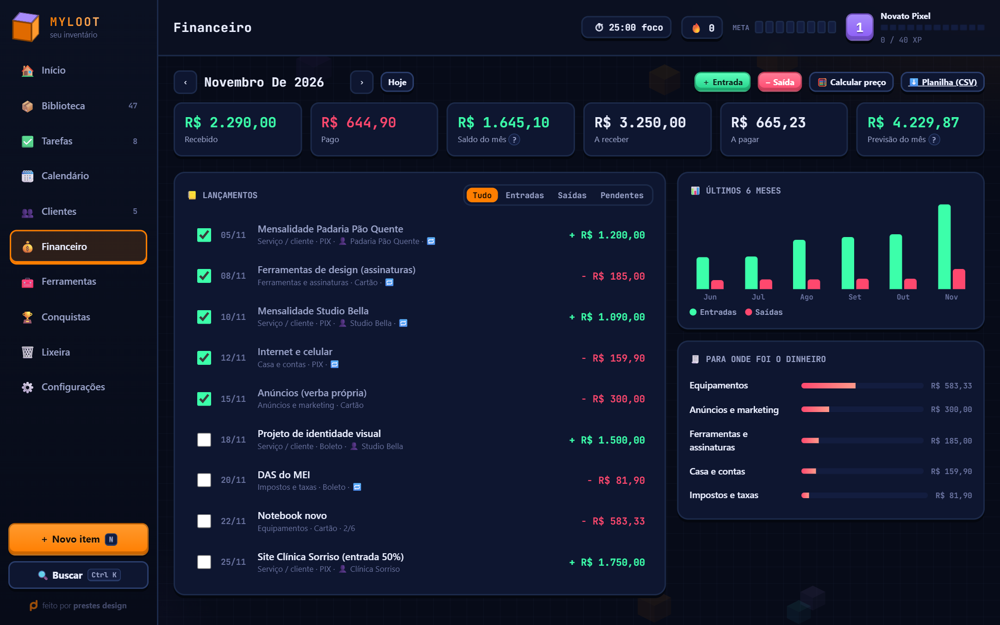
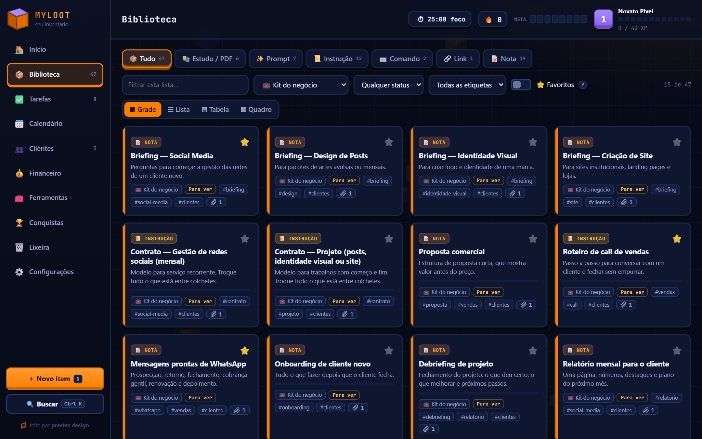
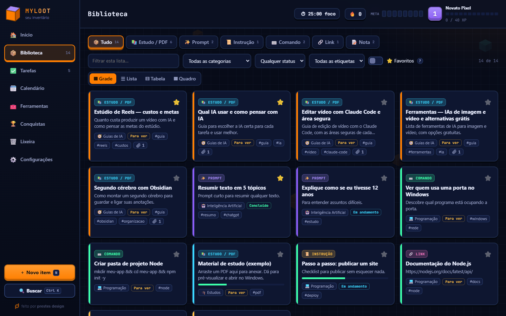
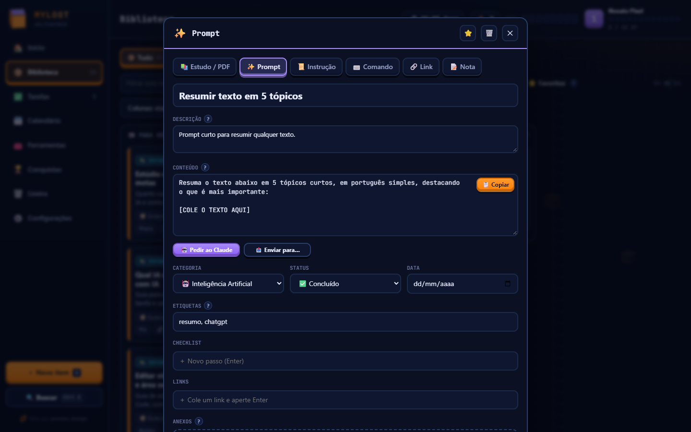
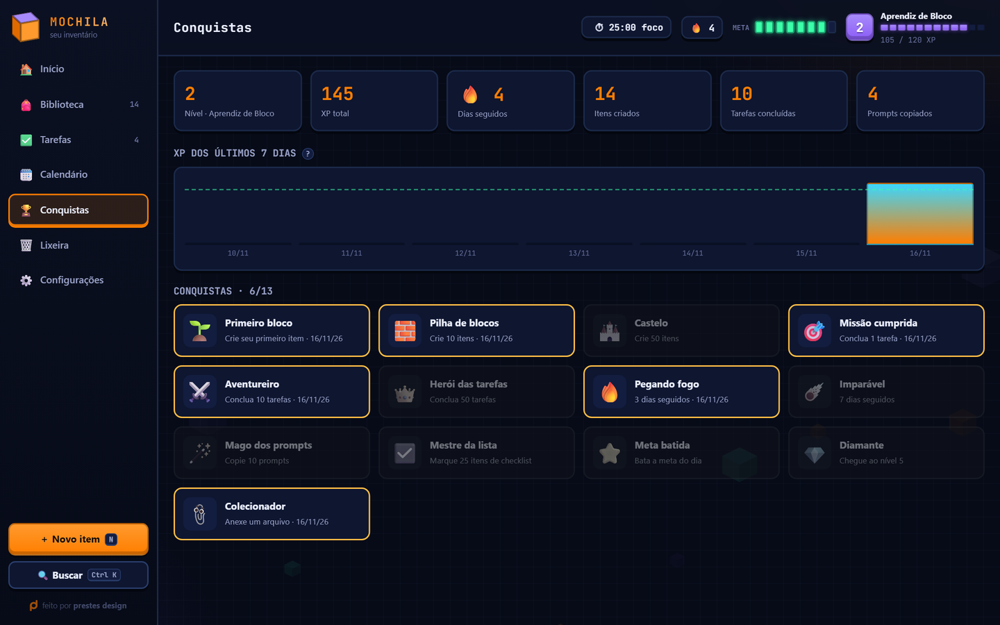
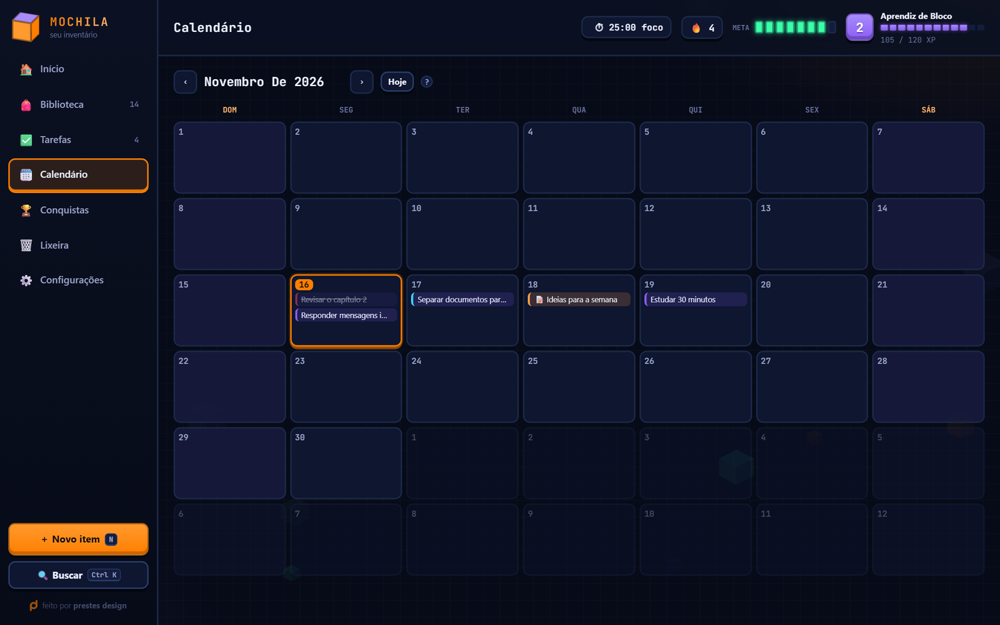

# MyLoot

**Seu inventário pessoal.** Um app que roda no seu próprio computador para guardar e achar rápido PDFs, prompts, comandos, links, notas, tarefas, clientes e o seu financeiro — com cara de joguinho: XP, níveis, missões, sons e confete.

Sem conta, sem nuvem, sem mensalidade. Seus dados ficam numa pasta sua. Funciona no **Windows, Mac e Linux**, e dá para usar **no celular** pela rede de casa.

🌐 **Site:** https://edirsooo.github.io/myloot/

▶️ **[Tutorial completo com som (3 min 28)](docs/video/myloot-tutorial.mp4)** · [apresentação rápida da versão anterior, quando se chamava Mochila (50 s)](docs/video/mochila.mp4)

⭐ Curtiu? Deixe uma estrela no repositório: ajuda outras pessoas a encontrarem o projeto.

## Novidades da versão 2.16

- 🔄 Sincronizar entre computadores: usa o MyLoot em mais de um PC? Ligue em Configurações → Google Drive e os dois ficam com os mesmos itens, tarefas, clientes, lançamentos e anexos, pela pasta do Google Drive (ou OneDrive, Dropbox). Se os dois mudarem o mesmo item, fica a mudança mais nova, campo a campo, e o que for apagado vai para a Lixeira do outro (precisa do Google Drive para computador instalado em todos os PCs)

## Novidades da versão 2.15.2

- 🤖 Codex: se você tem o app do ChatGPT (ou do Codex) para computador, o MyLoot agora acha e usa o Codex que vem dentro dele, já logado na sua conta, sem instalar nada pelo terminal

## Novidades da versão 2.15.1

- 🪟 Janela própria: no Windows, o MyLoot abre numa janela só dele, sem abas nem barra de endereço, e deixa um baú perto do relógio para abrir e fechar (dá para voltar ao navegador em Configurações → Servidor)
- 🤖 IA: o MyLoot agora acha o Claude Code e o Codex mesmo instalados depois de abrir o app ou fora do caminho padrão, e “Procurar de novo” funciona sem reiniciar
- 🧩 Sem a IA instalada, a chave fica desligada e aparece “como instalar”, com os comandos para copiar

## Novidades da versão 2.15
Esta versão aplica uma revisão completa das funções do app (o que dá para criar, mudar, desfazer e recuperar em cada tela).
- **Início:** o bloco "O que você quer guardar?" ficou maior, em duas colunas: à esquerda você escolhe Tarefa, Nota, Prompt ou Link; à direita escreve num campo claro, fala no microfone e guarda.
- **Compromissos:** no Calendário e em Tarefas dá para criar um compromisso com hora de início e fim. Ele não vira "atrasado": depois que passa, continua no dia do calendário.
- **Tarefas que repetem:** "Pular esta vez" leva para a próxima data sem concluir; "Encerrar repetição" mantém a tarefa e para de repetir. A repetição mensal guarda o dia certo (dia 31 volta a ser 31 depois de fevereiro). Todas as concluídas ficam visíveis em "Mostrar mais".
- **Financeiro:** ao mudar ou apagar um lançamento de conta fixa ou parcela, o app pergunta "só este" ou "este e os próximos". Conta fixa mostra até quando está prevista e tem "Renovar por mais 12 meses". O gráfico separa o que já foi pago ou recebido do que é previsão. Na ficha do cliente, cada pagamento abre o lançamento e pode ser marcado como recebido.
- **Arquivar e pausar:** itens, metas e ferramentas podem ser arquivados (saem da lista do dia a dia e continuam guardados). Hábitos podem ser pausados sem perder a sequência.
- **Lixeira:** hábitos, metas e ferramentas apagados agora vão para a Lixeira e podem ser restaurados.
- **Biblioteca:** botão "⋯" em cada cartão com as ações (duplicar, arquivar, mover, enviar), "Selecionar vários" para agir em muitos itens de uma vez e "Renomear etiqueta".
- **Ficha do item:** links e passos do checklist podem ser editados e mudar de ordem, anexos podem ser renomeados e o que ficou digitado entra ao salvar.
- **Backup completo:** um arquivo `.zip` com os registros e os anexos, que restaura tudo em outro computador. A tela também lista as cópias automáticas de cada dia, com "Restaurar esta cópia".
- **Google Drive:** arquivo que você editou direto na pasta do Drive não é mais sobrescrito nem apagado: vai para a pasta `_substituidos`.
- **Não perder nada:** se a gravação falhar, aparece uma faixa que não some, o app tenta de novo sozinho e guarda as mudanças no navegador. PC e celular mudando campos diferentes da mesma ficha ficam com as duas mudanças. O aviso de "você não salvou" cobre mais janelas.
- **Teclado e toque:** as janelas seguram o foco do teclado, cartões abrem com Enter, o mapa tem botões de zoom e os botões pequenos ganharam área de toque maior. O texto da página não é mais selecionado ao arrastar o mouse.

## Novidades da versão 2.14
- **Mascotes:** agora um bichinho voxel mora na sua tela (já vem ligado): Claude, GPT, Gemini, Pinguim, Coruja ou Slime. Em Configurações → Diversão → Mascote você troca, dá nome, escolhe o tamanho ou desliga.
- **Boas-vindas:** na primeira vez, os seis aparecem numa abertura animada e você escolhe o seu.
- **Ele reage ao que você faz:** abre o notebook quando você digita, comemora tarefa concluída e XP, faz festa no level up, pensa enquanto a IA trabalha, dança com a música e dorme quando você para.
- **Dá para brincar:** um clique é carinho; segure para levantar e balançar; chacoalhe e ele fica tonto; solte em cima de uma tarefa, de um cartão ou de um quadro e ele pisa ali; segure o clique em outro lugar e ele corre atrás. O botão direito troca, põe para dormir ou guarda.

## Novidades da versão 2.13
- **Minhas ferramentas:** a tela de Ferramentas tem duas abas. Em "Minhas ferramentas" você adiciona qualquer site ou programa (nome, link, para que serve, grupo), edita e remove. Em "Recomendadas" ficam as sugestões que vêm com o MyLoot; "Salvar" copia uma delas para as suas.
- **Histórico de ações:** o botão 🕘 no topo mostra o que você fez desde que abriu o app (criou, mudou, concluiu, apagou, anexou), com Desfazer e Refazer em cada linha. `Ctrl + Z` desfaz a última ação e `Ctrl + Y` refaz. No celular o histórico fica no menu "Mais" e na Lixeira. A lista vale enquanto o app está aberto; a Lixeira continua guardando o que foi apagado.
- **Desfazer em 5 segundos:** todo aviso que aparece depois de uma ação tem o botão Desfazer, com uma barrinha mostrando o tempo.
- **Repetir a música:** botão 🔁 no player para ficar na mesma faixa.

## Novidades da versão 2.12
- **Tutoriais em vídeo:** em Configurações → Tutorial há 5 vídeos de 30 a 40 segundos: MyLoot no celular em casa, fora de casa com o Tailscale, backup, IA e contas fixas e parcelas. No celular eles abrem na versão vertical.
- **iPhone:** o topo respeita a área do relógio e da ilha, e o app ocupa a altura toda quando aberto pela tela inicial.

## Novidades da versão 2.11
- **Player de música:** clicar (ou passar o mouse) no 🔈 do topo abre um pop-up com tocar/pausar, faixa anterior e próxima e o volume, que começa em 20%.
- **Configurações em seções:** menu agrupado em Geral, Conectar e Sistema; a tela mostra uma seção por vez, com título e explicação.
- **Menu lateral em grupos:** Organização, Gestão, Extras e Sistema, sem barra de rolagem (ele encolhe em telas baixas).
- **Sem perder o que digitou:** nas janelas de tarefa, lançamento, hábito e meta, sair pelo ✕, Esc ou clicando fora depois de mudar algo mostra “Continuar editando” ou “Sair sem salvar”. Itens e clientes continuam com rascunho automático.

## Novidades da versão 2.10
- **Mais fácil saber onde clicar:** as abas da Biblioteca (Tipo), dos Clientes (Status) e das Ferramentas (Grupo) têm rótulo e sublinhado; cada cartão mostra “Abrir →” e cada cliente “Abrir ficha →”. A Biblioteca ganhou uma frase dizendo para que serve, e a troca Grade/Lista/Tabela/Quadro fica separada dos filtros.
- **Tarefas:** título em cima, data e prioridade embaixo, ✕ na mesma linha; as colunas Atrasadas, Hoje e Próximas têm cor e contador. Em **Repetir** dá para escolher os dias da semana (ex.: seg, qua e sex).
- **Financeiro:** saldo do mês em destaque, entradas e saídas agrupadas, cabeçalho com a coluna “Pago?” e valores no gráfico.
- **Início:** “O que você quer guardar?” na barra rápida, “Para hoje” em destaque e “Meta do dia 0/50 XP” no topo.
- **Música de fundo:** o botão 🔈 do topo liga e desliga uma trilha instrumental. As faixas ficam em `public/musica` e o volume em Configurações → Diversão.

## Novidades da versão 2.9

- 🎯 **Rotina (hábitos)**: uma tela nova, inspirada no HabitNow. Crie hábitos com ícone, frequência (todo dia, dias da semana ou X vezes por semana), quantidade por dia (8 copos, 30 minutos) e lembrete. Um clique marca como feito; o 🔥 conta os dias seguidos e as bolinhas mostram os últimos 7 dias. Dá para voltar o dia e marcar o que esqueceu.
- 🏆 **Metas com progresso**: um número com prazo (faturar 10 mil no mês, fechar 5 clientes). Vá somando o que avançou; a barra enche e, em 100%, tem comemoração.
- 🗓️ **Mapa do mês**: cada dia fica mais forte conforme os hábitos cumpridos. O resumo também aparece no Calendário (🎯 2/3) e no Início, onde dá para marcar os hábitos de hoje.
- 🔢 **Números com ponto**: “10.000” agora é entendido como dez mil nas metas e no Financeiro.
- 👀 **Monitor grande sem cansar a vista (2.9.1)**: a Lixeira virou painéis por tipo, as Configurações têm um menu de seções e cartões em até três colunas, e as Tarefas e a Biblioteca em lista se dividem em colunas. O botão fica sempre perto do nome, sem linha atravessando a tela.

## Novidades da versão 2.8

- 📝 **Rascunho, como no Trello**: ao mudar um item ou um cliente que já existia, as mudanças ficam guardadas como rascunho até você clicar em “Salvar e fechar”. Se fechar sem salvar, o cartão continua com a versão antiga e ganha o selo “📝 rascunho”; ao abrir de novo, o que você tinha escrito está lá, com os botões “Salvar” e “Descartar alterações”.
- ↩️ **Voltar e avançar**: setas no topo (e os botões do navegador, ou Alt + setas) levam para a tela anterior. Se havia uma ficha aberta, ela reabre.
- 🧷 **Nada some no meio do cadastro**: uma janela aberta de dentro da ficha do cliente (tarefa, lançamento, modelos) volta para a ficha ao ser fechada, mesmo com Esc ou clique fora.

## Novidades da versão 2.7

- ✅ **Nova tarefa numa caixa só**: campo, microfone e botão Adicionar lado a lado; embaixo, data (Hoje, Amanhã ou calendário), hora do lembrete, prioridade e repetição. Cada opção tem um “?” que explica para que serve.
- 💾 **Salvar e fechar**: as fichas de item e de cliente continuam salvando sozinhas, mas agora têm o botão no rodapé; em cadastro novo aparece também “Descartar”.
- ⏱️ **Modo foco com a bolinha do mouse**: role em cima do timer (ou dentro da janela do foco) para mudar o tempo de 5 em 5 minutos, de 5 a 180. A janela traz 6 tempos prontos.
- 🧹 **Começo limpo**: uma instalação nova não vem mais com tarefas nem itens de exemplo, só a nota de boas-vindas e os materiais prontos.
- 👀 **Mais fácil de enxergar**: calendário e relógio dos campos com ícone claro, botão “? Tutorial” no lugar do emoji escuro, “＋ Novo cliente” e “＋ Entrada” perto do começo da tela.

## Novidades da versão 2.6

- 🎙️ **Microfone ao lado dos campos**: no título, na descrição e no conteúdo de um item, na tarefa nova, nas anotações do cliente e no lançamento do financeiro. Clique, fale, clique de novo: o texto entra no campo. (No computador; no celular use o microfone do teclado.)
- 🧩 **Novo item em 3 colunas**: os modelos cabem numa tela só, sem rolar, com os atalhos “Em branco” e “Por voz” no topo.

## Novidades da versão 2.5

- 🎙️ **Crie falando**: aperte o microfone (ou a tecla `V`), fale, e o que você disse vira nota, tarefa ou conta. Também aceita áudio do WhatsApp. A transcrição roda no seu computador (Whisper no navegador); na primeira vez ele baixa o motor de voz, uns 80 MB.
- ✨ **A IA organiza a fala**: “ligar pro Rafael amanhã às 10, paguei 120 de internet e anotar a ideia do post” vira uma tarefa com data e hora, uma conta paga e uma nota. Usa o Claude Code, o Codex ou a chave da API que você já ligou.
- 🔄 **Celular e PC juntos**: com os dois abertos, o que muda em um aparece no outro sem apagar nada. Áudio gravado no celular é transcrito pelo PC.
- 🐞 **Reportar um problema**: no menu e nas Configurações. Abre um formulário já preenchido com o que você escreveu, a versão e os últimos erros.
- 🎓 **Rever o tutorial**: o botão ao lado do nome de cada tela mostra de novo o passo a passo daquela tela.
- 🔌 **Conexões**: em Configurações, gere um código para outro programa do seu computador mandar itens para o MyLoot. Ele só acrescenta itens; não lê nem apaga o que você guardou.

## Novidades da versão 2.4

| No celular, por QR Code | Clientes |
|---|---|
|  |  |

| Financeiro | Kit do negócio |
|---|---|
|  |  |

## O que tem dentro

- **Mapa de conexões** na tela inicial, no estilo do Obsidian: cada item vira uma bolinha colorida pelo tipo e se liga sozinho a outros por etiquetas, categoria e menções (`[[Título]]`). Passe o mouse para ver as ligações, clique para abrir e amplie em tela cheia.
- **Biblioteca** com 6 tipos de item (Estudo/PDF, Prompt, Instrução, Comando, Link, Nota), categorias, etiquetas e favoritos.
- **4 jeitos de ver:** grade, lista, tabela e quadro estilo Trello (arrastando os cartões).
- **Busca em tudo** com `Ctrl+K` — títulos, textos, etiquetas e nome dos anexos.
- **Anexos:** arraste um arquivo para a janela e ele vira um item. Dá para pré-visualizar e abrir no programa do computador.
- **Clientes (mini CRM):** contato, WhatsApp, e-mail, Instagram, status do funil (prospect, ativo, pausado, encerrado), link do quadro do Trello e a pasta do cliente com um clique. As tarefas e os itens de cada cliente ficam juntos na ficha dele. Ótimo para social media e freelancer.
- **No celular:** ligue "Usar no celular" nas Configurações, aponte a câmera para o QR Code e pronto. Protegido por um código, só na sua rede. Dá para adicionar à tela inicial como um app.
- **Financeiro:** fluxo de caixa do mês com entradas e saídas, o que já foi pago/recebido e o que falta, contas que repetem todo mês, parcelas, pagamentos por cliente, gráfico dos últimos 6 meses, calculadora de valor da hora e planilha em CSV. O computador avisa das contas do dia.
- **Kit do negócio e Kit de lançamento:** 23 materiais prontos, cada um com texto editável e um PDF: briefings (social media, posts, identidade visual, site), contratos, proposta comercial, roteiro de call de vendas, mensagens de WhatsApp, onboarding, debriefing, relatório mensal, planejamento de conteúdo, avatar, objeções, oferta, cronograma e roteiro de lançamento. São **exemplos de referência** (os PDFs levam a identidade da Prestes Design): adapte para a sua marca, e cada material traz uma dica de como fazer isso com IA.
- **Tutorial guiado:** na primeira vez em cada tela, o MyLoot destaca os pontos principais passo a passo. Dá para pular e rever depois nas Configurações.
- **Modelos:** briefing de cliente, roteiro de Reels, checklist de post e reunião. Qualquer item pode virar modelo.
- **Instruções prontas:** prompts para o Claude Code ou o Codex organizarem seus arquivos (Downloads, fotos, repetidos, área de trabalho, pastas de clientes), sempre mostrando o plano antes e sem apagar nada.
- **Leitor em blocos:** arquivos `.md` e `.txt` abrem formatados em cartões fáceis de ler, com botão de copiar nos trechos de código.
- **Tarefas e calendário:** escreva "pagar conta amanhã" e a data entra sozinha. Tarefas podem **repetir** (todo dia, dias úteis, semana, mês) e ter **lembrete com horário**, que avisa no computador mesmo com o navegador fechado.
- **Modo foco:** timer que continua contando com o navegador fechado e avisa na área de trabalho.
- **Joguinho:** XP, níveis, meta do dia, missões, sequência de dias e conquistas. Tudo pode ser desligado.
- **IA (opcional): Claude ou Codex.** Peça para melhorar, corrigir ou resumir qualquer texto. O MyLoot acha sozinho o [Claude Code](https://claude.com/claude-code) e o [Codex](https://developers.openai.com/codex) instalados no seu PC e usa a sua própria assinatura, sem chave e sem custo extra. Na primeira vez, ele pergunta quais você quer usar. Sem nenhum dos dois, dá para colar uma chave da API do Claude.
- **Notion e Trello (opcional):** envie qualquer item para uma página do Notion ou para uma lista do Trello com um clique.
- **Google Drive (opcional):** copia tudo como arquivos `.md` para a sua pasta do Drive. O que você editar direto no Drive não é apagado: vai para a pasta `_substituidos`.
- **Sincronizar entre computadores (opcional):** quem usa o MyLoot em dois ou mais PCs liga em Configurações → Google Drive → *Sincronizar entre computadores*. Cada PC grava só o próprio arquivo na pasta `MyLoot-sync` do Drive e lê o dos outros ao abrir, a cada minuto e logo depois de salvar. Mudança no mesmo item: fica a mais nova, campo a campo; apagado vai para a Lixeira dos outros; antes da primeira junção o app guarda uma cópia automática. Precisa do **Google Drive para computador** (ou OneDrive, Dropbox) instalado e aberto em todos os PCs, com a mesma conta, e do relógio dos PCs certo. Configurações, XP e chaves (`data/segredos.json`) não vão para a nuvem.
- **Exportar para o Obsidian:** baixa um ZIP com tudo em Markdown (itens, anexos, clientes e tarefas), pronto para abrir como cofre.
- **Backup:** completo (`.zip` com os registros e os anexos, restaurável em outro computador), só dos registros (`.json` ou `.myloot` com senha, AES-256) e cópias automáticas de cada dia, restauráveis pela tela.
- **Central de ferramentas:** 42 links de IAs de imagem e vídeo e de programas de código aberto, com busca e botão para guardar na sua Biblioteca.
- **Já vem com 5 guias em PDF** sobre IA, edição de vídeo e organização.

| Biblioteca | Cartão do item |
|---|---|
|  |  |

| Quadro (arrastando os cartões) | Central de ferramentas |
|---|---|
|  |  |

| Leitor em blocos (.md e .txt) | Conquistas |
|---|---|
|  |  |

| Mapa de conexões | Calendário |
|---|---|
|  |  |

## Como instalar (Windows)

▶️ **[Veja o vídeo de instalação passo a passo (55 s)](docs/video/myloot-como-instalar.mp4)**

1. Instale o **Node.js** (versão LTS): https://nodejs.org — é só avançar até o fim.
2. Nesta página, clique no botão verde **Code → Download ZIP** e extraia a pasta onde quiser.
3. Dê dois cliques em **`Instalar.bat`**. Ele cria o atalho "MyLoot" na área de trabalho e abre o app.

Pronto. Nas próximas vezes, é só abrir pelo atalho.

O MyLoot abre **numa janela só dele**, como um programa (sem abas nem barra de endereço), e deixa um **baú perto do relógio**:

- **Clique no baú** para abrir a janela de novo.
- **Fechar a janela não desliga o MyLoot**: lembretes e o timer de foco continuam.
- Para desligar: botão direito no baú → **Fechar MyLoot**.
- No Windows 11, o baú pode começar escondido na setinha **^** perto do relógio. Arraste para fora se quiser ele sempre à vista.
- Prefere abrir numa aba do navegador? **Configurações → Servidor → Abrir o MyLoot: No navegador**.

Usa o Edge, que já vem no Windows (ou o Chrome, se não tiver o Edge). Não instala nada além do atalho.

## Como instalar (Mac)

1. Instale o **Node.js** (versão LTS): https://nodejs.org
2. Baixe o ZIP (botão verde **Code → Download ZIP**) e extraia.
3. Clique com o **botão direito** em **`Instalar.command`** → **Abrir** → **Abrir** de novo (o Mac pede essa confirmação na primeira vez porque o arquivo veio da internet).

Ele cria o app **MyLoot** na Mesa, com o ícone do baú, e já abre.

## Como instalar (Linux)

1. Instale o **Node.js** (versão LTS) pelo site ou pelo gerenciador de pacotes.
2. Baixe o ZIP e extraia.
3. No terminal, dentro da pasta: `sh instalar.sh`

Ele coloca o MyLoot no menu de aplicativos e na área de trabalho.

## Usar no celular

1. No computador: **Configurações → Usar no celular** → ligue a chave.
2. No celular (no mesmo Wi-Fi): aponte a câmera para o QR Code, ou digite o endereço que aparece e o código de 6 números.
3. Para virar app: no menu do navegador, **Adicionar à tela inicial**.

O computador precisa estar ligado com o MyLoot aberto. No Windows, se aparecer o aviso do firewall, permita em **redes privadas**. Para usar fora de casa, instale o [Tailscale](https://tailscale.com) (grátis) no PC e no celular. Algumas coisas ficam só no computador: desligar, atualizar, trocar chaves e abrir arquivos no PC.

> Antes se chamava **Mochila**. Se você já usava, é só copiar a versão nova por cima: seus dados continuam iguais.

> Não precisa de `npm install`: o app usa só o que já vem com o Node.

## Como usar

| Tecla | O que faz |
|---|---|
| `Ctrl+K` ou `/` | Buscar em tudo ou dar um comando |
| `N` | Novo item |
| `V` | Criar por voz |
| `H` `B` `T` `C` `L` `M` | Início, Biblioteca, Tarefas, Calendário, Clientes, Financeiro |
| `F` | Começar ou parar o foco |
| Clique direito no cartão (no celular: segurar o dedo) | Abrir, copiar, favoritar, enviar ao Notion/Trello, mover, duplicar, lixeira |

Para desligar: **Configurações → Desligar**.

## Onde ficam os meus dados?

Tudo fica na pasta `data/`, dentro da pasta do app:

- `data/db.json` — itens, tarefas e progresso
- `data/anexos/` — os arquivos que você anexou
- `data/backups/` — uma cópia automática por dia (guarda as 20 mais novas), restauráveis em Configurações → Dados e backup

A chave da API do Claude e as do Notion e do Trello ficam em `data/segredos.json`, fora do backup e do GitHub.

Nada sai do seu computador, a não ser que você ligue o Drive (cópia ou sincronização entre computadores), use o Claude ou envie um item para o Notion/Trello.

## Como atualizar

A partir da versão 2.2, **o próprio MyLoot avisa** quando sai versão nova: é só clicar em **Atualizar agora**. Ele baixa do GitHub, troca só os arquivos do app e reabre sozinho, sem mexer nos seus itens. Dá para procurar na hora em **Configurações → Versão**.

Se você tem uma versão mais antiga (ou ainda a Mochila), baixe o ZIP novo uma última vez e copie por cima, **menos a pasta `data/`**. Seus dados são migrados sozinhos ao abrir.

## Por dentro

- Servidor: Node.js puro (`server.js`, `integracoes.js`, `celular.js`, `exportar.js`), sem dependências. Só em `127.0.0.1:4321`, a não ser que você ligue "Usar no celular".
- Interface: HTML, CSS e JavaScript puros em `public/`.
- Conteúdo inicial: arquivos em `exemplos/` (cada `.json` é um pacote que entra uma vez só).

## Novidades

O repositório vai sendo atualizado: quando houver material novo (guias, links, melhorias), ele entra aqui e o app avisa você.

## Licença

[MIT](LICENSE) — use, mude e compartilhe à vontade.

Feito por [Prestes Design](https://prestesdesign.com.br) com ajuda do Claude.
