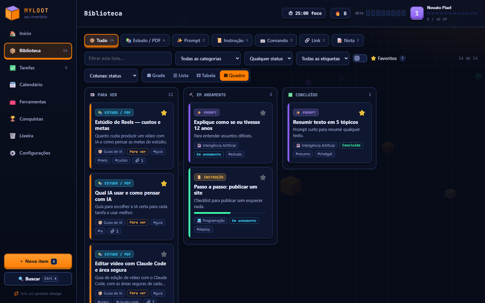
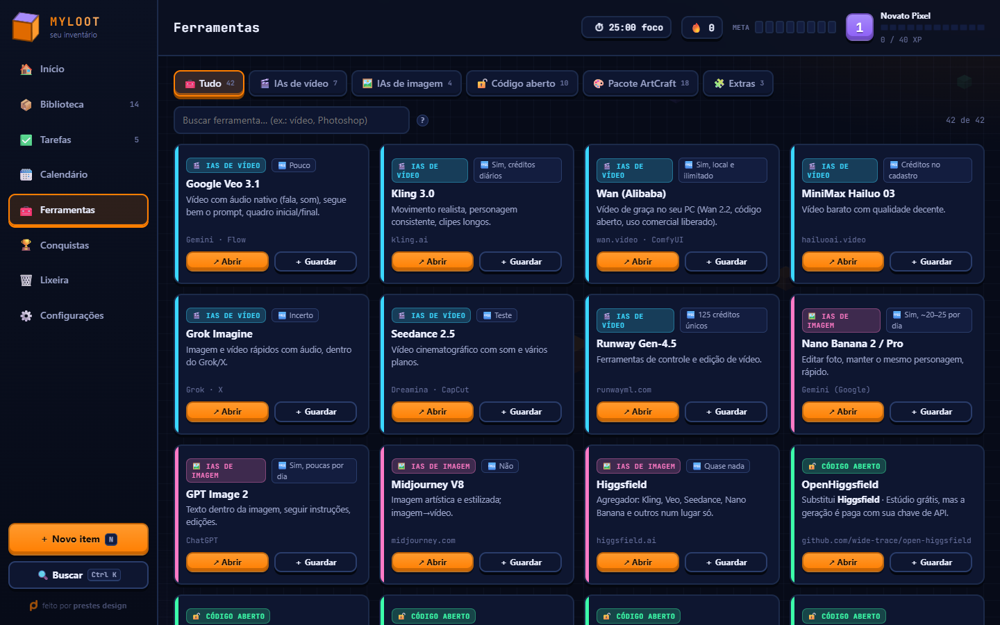
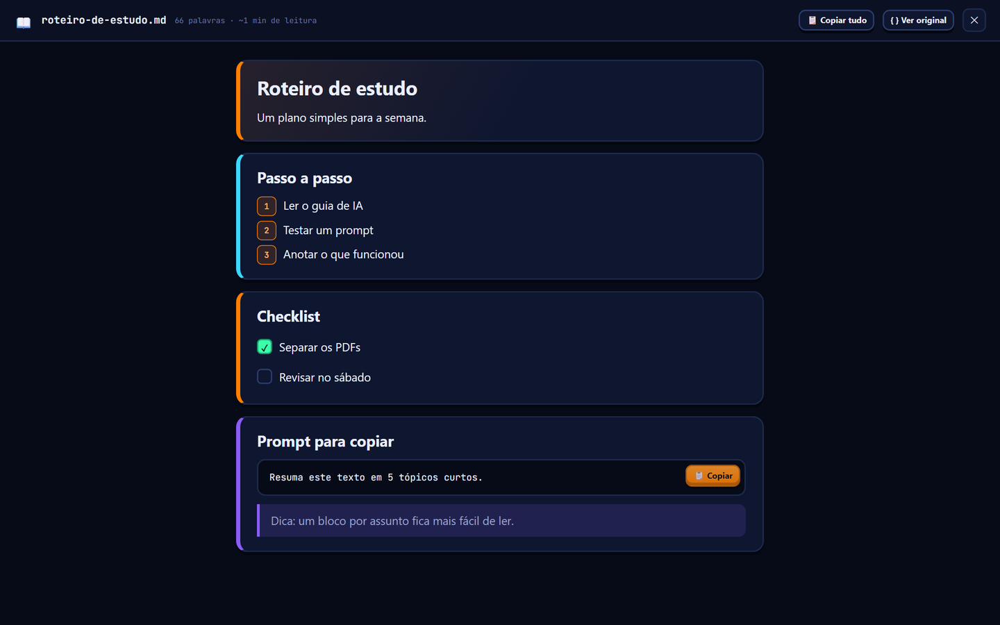

# MyLoot

**Seu inventário pessoal.** Um app que roda no seu próprio computador para guardar e achar rápido PDFs, prompts, comandos, links, notas e tarefas — com cara de joguinho: XP, níveis, missões, sons e confete.

Sem conta, sem nuvem, sem mensalidade. Seus dados ficam numa pasta sua.

▶️ **[Tutorial completo com som (2 min 37)](docs/video/mochila-tutorial.mp4)** · [apresentação rápida (50 s)](docs/video/mochila.mp4)

⭐ Curtiu? Deixe uma estrela no repositório: ajuda outras pessoas a encontrarem o projeto.

## O que tem dentro

- **Mapa de conexões** na tela inicial, no estilo do Obsidian: cada item vira uma bolinha colorida pelo tipo e se liga sozinho a outros por etiquetas, categoria e menções (`[[Título]]`). Passe o mouse para ver as ligações, clique para abrir e amplie em tela cheia.
- **Biblioteca** com 6 tipos de item (Estudo/PDF, Prompt, Instrução, Comando, Link, Nota), categorias, etiquetas e favoritos.
- **4 jeitos de ver:** grade, lista, tabela e quadro estilo Trello (arrastando os cartões).
- **Busca em tudo** com `Ctrl+K` — títulos, textos, etiquetas e nome dos anexos.
- **Anexos:** arraste um arquivo para a janela e ele vira um item. Dá para pré-visualizar e abrir no Windows.
- **Leitor em blocos:** arquivos `.md` e `.txt` abrem formatados em cartões fáceis de ler, com botão de copiar nos trechos de código.
- **Tarefas e calendário:** escreva "pagar conta amanhã" e a data entra sozinha.
- **Modo foco:** timer que continua contando com o navegador fechado e avisa na área de trabalho.
- **Joguinho:** XP, níveis, meta do dia, missões, sequência de dias e conquistas. Tudo pode ser desligado.
- **Claude (opcional):** peça para melhorar, corrigir ou resumir qualquer texto. Se você tem o [Claude Code](https://claude.com/claude-code) instalado e logado, ele usa a sua assinatura, sem chave e sem custo extra. Se não tiver, dá para usar uma chave da API.
- **Notion e Trello (opcional):** envie qualquer item para uma página do Notion ou para uma lista do Trello com um clique.
- **Google Drive (opcional):** copia tudo como arquivos `.md` para a sua pasta do Drive.
- **Central de ferramentas:** 42 links de IAs de imagem e vídeo e de programas de código aberto, com busca e botão para guardar na sua Biblioteca.
- **Já vem com 5 guias em PDF** sobre IA, edição de vídeo e organização.

| Biblioteca | Cartão do item |
|---|---|
|  |  |

| Quadro (arrastando os cartões) | Central de ferramentas |
|---|---|
|  |  |

| Leitor em blocos (.md e .txt) | Conquistas |
|---|---|
|  |  |

| Mapa de conexões | Calendário |
|---|---|
|  |  |

## Como instalar (Windows)

1. Instale o **Node.js** (versão LTS): https://nodejs.org — é só avançar até o fim.
2. Nesta página, clique no botão verde **Code → Download ZIP** e extraia a pasta onde quiser.
3. Dê dois cliques em **`Instalar.bat`**. Ele cria o atalho "MyLoot" na área de trabalho e abre o app.

Pronto. Nas próximas vezes, é só abrir pelo atalho.

> Antes se chamava **Mochila**. Se você já usava, é só copiar a versão nova por cima: seus dados continuam iguais.

> Não precisa de `npm install`: o app usa só o que já vem com o Node.

## Como usar

| Tecla | O que faz |
|---|---|
| `Ctrl+K` ou `/` | Buscar em tudo ou dar um comando |
| `N` | Novo item |
| `H` `B` `T` `C` | Início, Biblioteca, Tarefas, Calendário |
| `F` | Começar ou parar o foco |
| Clique direito no cartão | Abrir, copiar, favoritar, enviar ao Notion/Trello, mover, duplicar, lixeira |

Para desligar: **Configurações → Desligar**.

## Onde ficam os meus dados?

Tudo fica na pasta `data/`, dentro da pasta do app:

- `data/db.json` — itens, tarefas e progresso
- `data/anexos/` — os arquivos que você anexou
- `data/backups/` — uma cópia automática por dia (guarda as 20 mais novas)

As chaves do Claude, do Notion e do Trello ficam em `data/segredos.json`, fora do backup e do GitHub.

Nada sai do seu computador, a não ser que você ligue o Drive, use o Claude ou envie um item para o Notion/Trello.

## Como atualizar

Baixe o ZIP novo e copie por cima, **menos a pasta `data/`**. Seus dados são migrados sozinhos ao abrir.

## Por dentro

- Servidor: Node.js puro (`server.js` e `integracoes.js`), sem dependências, só em `127.0.0.1:4321`.
- Interface: HTML, CSS e JavaScript puros em `public/`.
- Conteúdo inicial: arquivos em `exemplos/` (cada `.json` é um pacote que entra uma vez só).

## Novidades

O repositório vai sendo atualizado: quando houver material novo (guias, links, melhorias), ele entra aqui. Para receber, baixe o ZIP de novo e copie por cima, sem mexer na pasta `data/`.

## Licença

[MIT](LICENSE) — use, mude e compartilhe à vontade.

Feito por [Prestes Design](https://prestesdesign.com.br) com ajuda do Claude.
